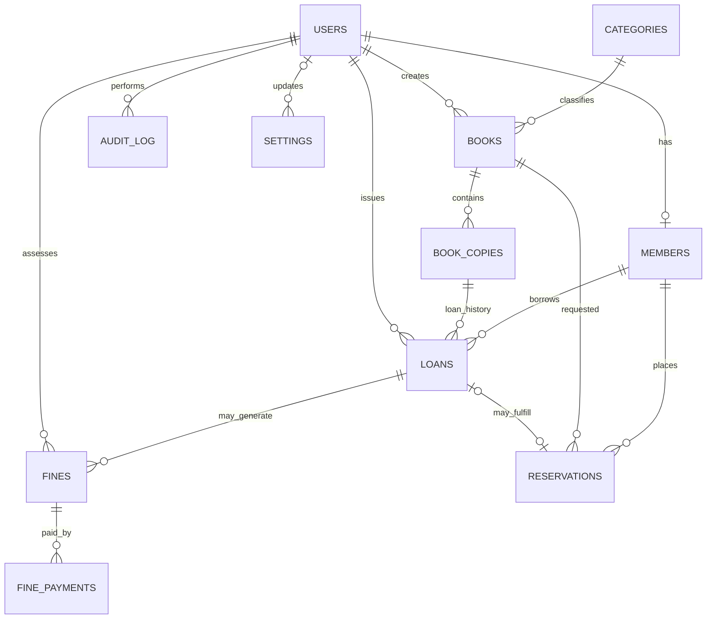

# Library Management System ERD

## Important design notes

- `books` stores title-level metadata. `book_copies` stores individual physical copies and unique barcodes.
- `loans` reference one `book_copies` row. `active_book_copy_id` is a generated column with a unique index, so only one active loan can refer to a copy at a time.
- `reservations.active_member_book_id` is generated for pending/ready holds. Together with `member_id`, its unique index prevents the same member from having duplicate active reservations for the same title.
- The rule preventing the same member from having two active loans for the same title must also be checked in a transactional application service, since it spans the `loans`, `book_copies`, and `books` tables.
- Overdue is a calculated condition: a loan has `status = 'active'` and its due date is past the library's cutoff. It is not a separate loan status in the schema.
- Fine balances are calculated from `fines.amount_assessed` minus `fine_payments.amount`. The `fines.status` field is maintained transactionally by the fine service. A waived fine must not accept additional payments.
- Deactivate or archive patrons/titles with transaction history rather than deleting them.
